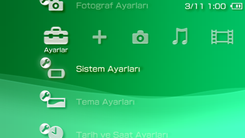
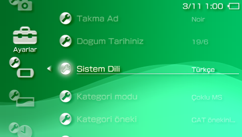
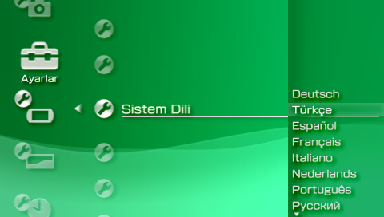
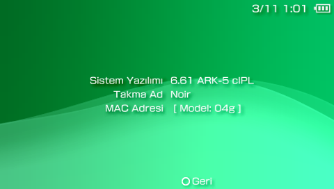

# Localizer PSP — ARK-5 Port

**English** | [Türkçe](README.tr.md)

## About the Original Project

**Localizer™: Translate your XMB!** is a PSP homebrew plugin originally developed by **Draan**.
Its purpose is to allow users to translate XMB themes that use languages not officially supported by the PSP.
With Localizer, users can enjoy their favourite CTF and F0 themes, switch between themes using plugins such as CXMB, and have their XMB translated into their preferred language.

Originally released as an entry for the **PSP Genesis Competition 2011**, Localizer received recognition as *Wololo's Favourite Open Source Entry* in the Plugins category.

This project preserves the original concept and functionality created by Draan.

## About This Port

The original release supported firmware versions such as 6.60 and PRO LME.
This port adapts the project for **PSP firmware 6.61 running ARK-5** (tested with ARK 5.1.0).

The original source code was reviewed, and the firmware-compatibility parts were analysed and adjusted for the ARK-5 environment with assistance from Anthropic Claude. The adapted build was subsequently tested on real hardware.

The goal of this port is to bring Localizer to PSP systems running 6.61 ARK-5 while preserving the original functionality and vision of the project.

### What changed compared to the original

* **6.61 support.** 6.61 reports devkit version `0x06060110`, which the original did not know, so it silently patched nothing. It now uses the 6.60 layout (the 6.60 and 6.61 `paf.prx` / `sysconf_plugin.prx` are identical at every patched address).
* **Safety checks.** The hard-coded offsets are verified (call targets, export slots) before anything is patched; on a mismatch the plugin leaves the firmware untouched instead of crashing.
* **ARK-5 crash fix.** On ARK-5 the console powered off right after the plugin started. Loading the embedded user module immediately from the plugin loader's context crashes it, and so does a long `sceKernelDelayThread` before it. A little file IO before each step (see `settle()` in `src/kernel/main.c`) is what works, so the kernel module does that. `-DLOC_K_SLEEP` selects a 10 ms sleep instead, which was also tested.
* **No crash without `localizer.dat`.** A missing database used to dereference a NULL pointer.
* **Optional debug logs** (`./build.sh debug`) – `ms0:/seplugins/localizer.log` and `localizer_k.log`. The release build writes nothing.
* **Builds with a current toolchain** ([pspdev](https://pspdev.github.io), GCC 15) instead of the 2011 PSPSDK.
* **About image cycle.** The System Information page loads a single image (`flash0:/vsh/resource/name_plate.png`). Each time it is opened the plugin serves the next one: `semihnoir.png` → `genesis.png` → the original PSP image.
* **Turkish database** (`strings/strings_tr.txt`, `dist/localizer_tr.dat`).

## Screenshots

Real hardware: PSP-3000, firmware 6.61 with ARK-5.

| | |
|---|---|
|  |  |
| Settings menu | System Settings with the language entry |
|  |  |
| Language list (the "English" slot now reads Türkçe) | System Information on 6.61 ARK-5 |

## Installation

Requirements: a PSP on **firmware 6.61 with [ARK-5](https://github.com/PSP-Arkfive/FasterARK/)** (tested with ARK 5.1.0). **[ARK-4](https://github.com/psp-archive/ark-4) support has not been tested.**

1. **Get the files.** Download the release zip and extract it, or take `dist/localizer.prx` and a database (`dist/localizer_tr.dat`) from this repository. The Turkish release zip already contains the database as `localizer.dat`; if you take it from `dist/`, rename `localizer_tr.dat` to `localizer.dat`.
2. **Copy to the Memory Stick.** Put `localizer.prx` and `localizer.dat` into `ms0:/seplugins/` (`ef0:/seplugins/` on a PSP Go). Create the `seplugins` folder if it does not exist. Both files must keep exactly these names.
3. **Enable the plugin.** Open the ARK plugin list `ms0:/seplugins/PLUGINS.TXT` (create it if missing; older CFW use `vsh.txt`) and add this line:
   ```
   vsh, ms0:/seplugins/localizer.prx, on
   ```
   On a PSP Go use `ef0:/...` in the path.
4. **Reboot** into ARK-5. The XMB menus are now translated, and the System Information page cycles through the author images.

`localizer.dat` is looked up in `ef0:/seplugins/` first, then `ms0:/seplugins/`.

To uninstall, set the line to `off` or delete it, and delete the two files.

**Troubleshooting:** nothing translated → check the file names/location and the plugin line; console shuts down at boot → replace `localizer.prx` with `dist/localizer_debug.prx`, reboot, and send the generated `localizer.log` / `localizer_k.log` (see Status below).

## Building

Plugin (Linux / WSL with [pspdev](https://pspdev.github.io) installed):

```bash
./build.sh          # dist/localizer.prx
./build.sh debug    # dist/localizer_debug.prx (writes the log files)
```

Language database (Windows, uses Draan's `Paxor.exe`; its source is in `src/Paxor3`):

```bat
tools\make_db.bat tr      :: strings\strings_tr.txt -> dist\localizer_tr.dat
```

## Writing translations – things worth knowing

* The strings file is UTF-16 LE with BOM, one `'label' = 'text'` entry per line. Keep `%1`, `%2`, `™`, `®` and the invisible button glyphs (U+F8xx) intact.
* **Paxor ends a text at the first `'`.** An apostrophe inside a value silently cuts the string, so avoid it (this is why e.g. Turkish suffixes after names are written without an apostrophe).
* The XMB font has no glyph for some characters; they show up as `_`. For Turkish that affects `ğ Ğ ş Ş İ`, so the Turkish file uses `g G s S I` instead (`ı ö ü ç` work).

## Status

Tested on firmware **6.61 + ARK 5.1.0**: `dist/localizer.prx` (silent release build) loads, the XMB is translated, texts are no longer cut, and the About image cycle works.

**ARK-4 support has not been tested** (only [ARK-5](https://github.com/PSP-Arkfive/FasterARK/) was). If you try it on [ARK-4](https://github.com/psp-archive/ark-4), please report the result.

If anything misbehaves, try `dist/localizer_debug.prx` and look at `localizer.log` / `localizer_k.log` in `seplugins`.

### Tested consoles / TODO

| Model | Status |
|---|---|
| PSP-3000 | tested, works |
| PSP-1000 | not tested yet |
| PSP-2000 | not tested yet |
| PSP Street (E1000) | not tested yet |
| PSP Go (N1000) | not tested yet (the plugin looks for `ef0:/seplugins/localizer.dat` first, but this path has never been run on real hardware) |

- [ ] Test on PSP-1000
- [ ] Test on PSP-2000
- [ ] Test on PSP Street (E1000)
- [ ] Test on PSP Go (N1000)

If you tried it on one of these, please open an issue with the model, firmware, ARK version and (if it crashes) the logs from `dist/localizer_debug.prx`.

## Translations & contributions

The project is **open to pull requests for translations into other languages**. Add `strings/strings_<lang>.txt` (copy `strings/strings_eng.txt` and translate the values, keeping the format rules above), build it with `tools\make_db.bat <lang>` and send a PR. Fixes and improvements to the plugin itself are welcome too.

## Credits & Links

* **Original developer:** Draan (Herby)
* **Original project:** [Localizer PSP — GameBrew](https://www.gamebrew.org/wiki/Localizer_PSP)
* **Compatibility port & adaptation:** [SemihNoir](https://github.com/semihnoir)
* **AI-assisted development:** Anthropic Claude (contributor)
* Draan's own credits (Bubbletune, Davee, krzychuuu & Erokesha, mint) are kept in [`docs/README_original_Draan.txt`](docs/README_original_Draan.txt), which must stay with any redistribution.

## Licence / Disclaimer

This is an **unofficial** compatibility port. Localizer™ remains the original work of Draan; all credit for the original plugin, concept and development belongs to its creator.
The original readme allows redistribution as long as its information is kept; no other licence was published with the source, so none is added here.
**Use at your own risk.**

## Repository layout

```
assets/    images shown in System Information
dist/      built plugin (release + debug) and Turkish database
docs/      original readmes
src/       kernel/ user/ (plugin), Paxor3/ (database tool)
strings/   translation sources (English reference, Turkish, old Polish sample)
tools/     Paxor.exe and make_db.bat
build.sh   plugin build script
```
